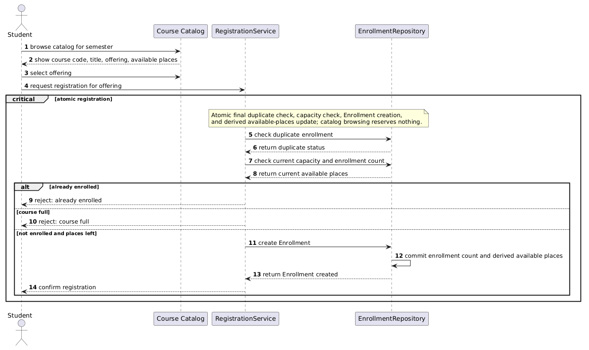
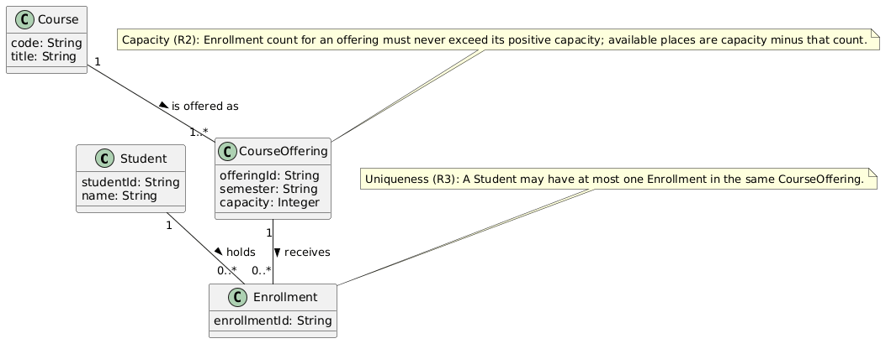
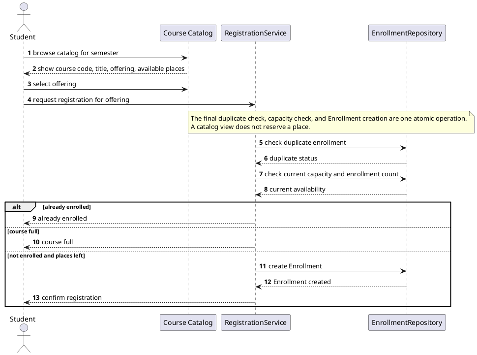
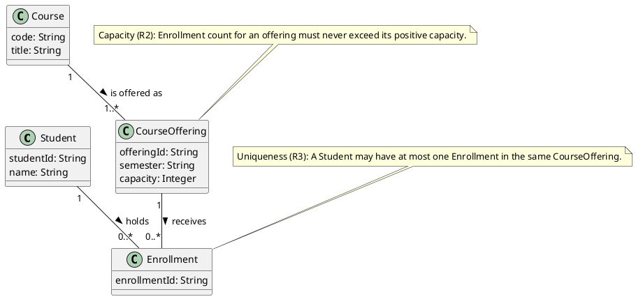
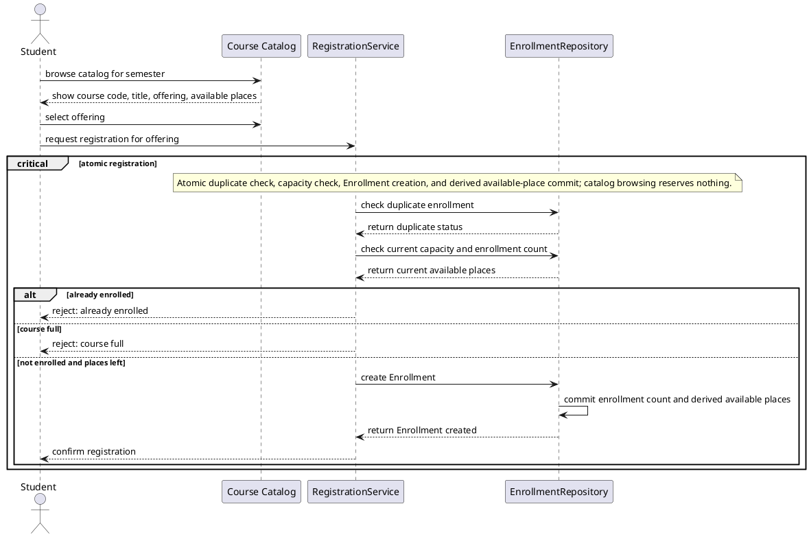
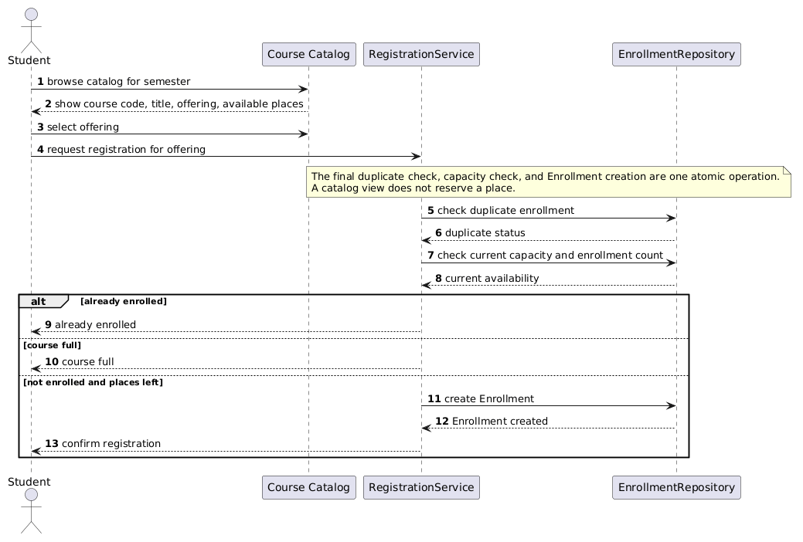
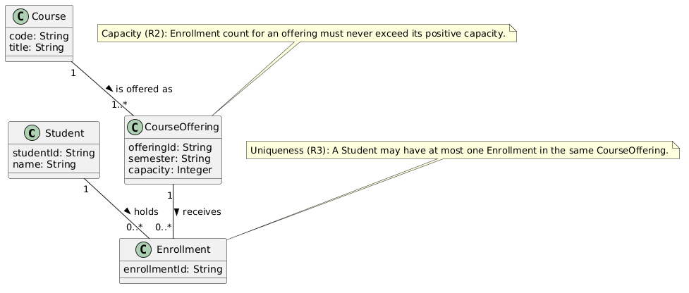

# SIS #02 — AI-Assisted UML Modeling: University Course Registration

## 1. Scope and assumptions

**Scope**: Model catalog browsing and atomic registration for one existing course offering in one semester, including capacity, duplicate prevention, confirmations, and clear rejections; payments, prerequisites, timetable clashes, waiting lists, and cancellation are out of scope

**Assumptions**:

1. The student is signed in, and each registration request identifies one existing CourseOffering
2. Capacity is a positive whole number, and available places are calculated from capacity minus current enrollments
3. The final registration transaction serializes concurrent requests for the same offering

## 2. User stories and acceptance criteria

### US-01 — Browse offerings

**US-01:** As a student, I want to browse semester offerings, so that I can choose a specific offering to register for.

- **AC-01** (R1): Given a student opens the catalog for one semester, When the catalog is displayed, Then each listed offering shows its course code, title, offering identifier, and available places.
- **AC-02** (R1): Given the catalog shows several offerings, When the student selects one offering, Then the system identifies that specific offering for a later registration request without reserving a place.

### US-02 — Register for an offering

**US-02:** As a student, I want to register for a selected offering, so that I receive an enrollment when a place is available.

- **AC-03** (R2, R3): Given the student requests registration for a selected offering, When the system performs final duplicate and capacity checks atomically, Then it accepts only a student who is not already enrolled and whose offering has a place left.
- **AC-04** (R2, R4): Given the final checks find no duplicate and a place left, When registration succeeds, Then the system creates exactly one Enrollment, updates available places, and returns a confirmation.

### US-03 — Receive a clear rejection

**US-03:** As a student, I want a clear registration rejection, so that I know why no enrollment was created.

- **AC-05** (R3, R5): Given the student already has an enrollment in the selected offering, When the student requests registration again, Then the system returns already enrolled, creates no Enrollment, and leaves the enrollment count unchanged.
- **AC-06** (R2, R5): Given the offering has no places left at the final check, When the student requests registration, Then the system returns course full, creates no Enrollment, and leaves the enrollment count unchanged.

## 3. Sequence diagram



**Participants:** Student is the signed-in actor, Course Catalog displays semester information, RegistrationService coordinates the request; EnrollmentRepository reads and commits Enrollment data

**Atomic operation:** The `critical atomic registration` block contains the final duplicate check, capacity/count check, Enrollment creation, and derived available-places update. Browsing occurs earlier and reserves nothing, so a stale catalog view cannot bypass these final checks

**Where the Enrollment is created:** `RegistrationService -> EnrollmentRepository : create Enrollment` creates the `Enrollment` class shown in section 4; its commit message records the new enrollment count and derived availability before confirmation

**Technical lifelines:** Course Catalog, RegistrationService, and EnrollmentRepository are technical lifelines rather than domain classes. They represent presentation, application coordination, and persistence responsibilities; Student is the domain actor

## 4. Class diagram



| Association | Read left to right | Read right to left |
| --- | --- | --- |
| Student "1" -- "0..*" Enrollment | One Student holds zero or more Enrollments. | Each Enrollment belongs to exactly one Student. |
| CourseOffering "1" -- "0..*" Enrollment | One CourseOffering receives zero or more Enrollments. | Each Enrollment targets exactly one CourseOffering. |
| Course "1" -- "1..*" CourseOffering | One Course is offered as one or more CourseOfferings. | Each CourseOffering describes exactly one Course. |

**How an Enrollment links a student to an offering:** Each Enrollment is simultaneously associated with exactly one Student and exactly one CourseOffering, making it the registration record between those two domain objects.

**Capacity constraint:** The R2 note states that an offering's enrollment count never exceeds its positive capacity, with available places derived from the difference. Multiplicity cannot compare a changing count with an attribute value.

**Uniqueness constraint:** The R3 note permits at most one Enrollment for a particular Student and CourseOffering pair. Multiplicity alone cannot constrain the uniqueness of that pair across records.

## 5. Traceability

| Rule and criterion | Model evidence | Validation case |
| --- | --- | --- |
| R1 + AC-01, AC-02 | show course code, title, offering, available places and the Course/CourseOffering attributes | Extra catalog inspection before T1 |
| R2 + AC-03, AC-04, AC-06 | Atomic capacity/count message, course full guard, capacity note | T1, T2, T3 |
| R3 + AC-03, AC-05 | Final duplicate message, already enrolled guard, uniqueness note | T4 |
| R4 + AC-04 | create Enrollment, commit derived places, then confirm registration | T1, T2 |
| R5 + AC-05, AC-06 | State-neutral reject: already enrolled and reject: course full messages | T3, T4 |

## 6. Walkthroughs

| Case | Observed path and state change | Judgment and evidence |
| --- | --- | --- |
| T1. Available | Student browses and selects, then requests registration. The critical block checks no duplicate and current capacity 2 with count 0. The success guard applies; `create Enrollment` commits count 0 to 1 and derived available places 2 to 1, then confirmation returns. | Pass — success guard, `create Enrollment`, and `confirm registration` messages. |
| T2. Last place | Student sends the same request path after browsing. The final duplicate check is clear and the capacity/count check observes capacity 2 and count 1. The success guard applies; creation commits count 1 to 2 and derived available places 1 to 0 before confirmation. | Pass — atomic critical block and success-branch commit message. |
| T3. Full | The earlier catalog display can show a place, but request processing rereads current capacity and enrollment count as 2 of 2. The `course full` guard applies. It returns `reject: course full`; no Enrollment is created, so count remains 2 and available places remain 0. | Pass — `else course full` guard and its rejection message. |
| T4. Duplicate | Student requests an already selected offering, and the final duplicate check returns that an enrollment exists. The `already enrolled` guard applies before capacity affects the decision. It returns the rejection only; no record is created, so the count remains 1. | Pass — `alt already enrolled` guard and state-neutral rejection message. |

## 7. Review decisions

| AI suggestion or model element | Decision | Reason | Rule |
| --- | --- | --- | --- |
| Original success branch created Enrollment but showed no explicit committed availability result. | Accepted and modified: added commit enrollment count and derived available places before confirmation. | AC-04 requires availability to update, and the added commit makes the T1 and T2 state transition visible without storing a duplicate attribute. | R2, R4 |
| Critique proposed expanding the atomic note to cover the availability result. | Accepted and modified: placed all final work in a critical atomic registration block and revised the note. | A critical block gives a stronger visible boundary than prose alone and shows that competing requests cannot interleave creation after stale checks. | R2 |
| Original Course, CourseOffering, and Enrollment multiplicities and the two constraints. | Accepted without structural change after inspection. | The original associations already give one Student and one CourseOffering per Enrollment, while separate notes correctly express capacity and pair uniqueness. | R2, R3 |
| Add an extra domain class for catalog display or repository behavior. | Rejected; kept technical lifelines only in the sequence diagram. | The required domain model is complete with four classes, and adding a display class would blur domain associations with implementation responsibilities. | R1, R4 |

## 8. Modeling explanation

The model separates the stable registration domain from the interaction that changes it. The class diagram uses Student, Course, CourseOffering, and Enrollment because an offering is the scheduled target of registration, while Course supplies the code and title displayed in the catalog. Enrollment is an association-like domain record: each record links one student to one offering, and both owners can have many records over time. multiplicity can say that an offering has many enrollment records, but it cannot compare that changing number with the offering's capacity or prohibit a repeated Student–CourseOffering pair.

The sequence diagram starts with browsing and selection to make R1 visible, but treats that view as informational. After the registration request, the critical atomic block rechecks duplicate status and current capacity. Its alternatives put the two rejection reasons before the success path. Only the success path creates Enrollment, commits the resulting count and derived available places, and sends confirmation. Thus the message order explains why T3 is rejected even after a stale catalog view and why T2 consumes the last place safely. Overall sequence diagram uses four lifelines to show how the student browses the catalog and how RegistrationService checks enrollment data through EnrollmentRepository before processing registration.

## 9. Reflection

model was useful for producing an initial pair of diagrams and for drawing attention to the missing visible availability update. It also gave me a compact critique structure that made it easier to compare the original sequence messages with AC-04 instead of accepting the first diagram automatically. I kept the original class associations after checking them carefully: the Student and CourseOffering ends both read as one per Enrollment, and the many ends describe the collection of enrollment records

My main revision was to use a scritical block. This makes the state change readable in the last-place case: count moves from one to two and derived places move from one to zero before confirmation. I also made both rejection branches state-neutral, so the walkthrough has a specific location for that claim.

One limitation remains that the diagram deliberately does not specify a concrete database isolation mechanism
Overall gpt 5.6-terra did great job on defining diagrams. Class diagramm only needed more specific commentary on the relationships, whilst sequence diagram should account for atomicity requireemnt. s

## 10. Appendix A — Before AI

**Scope:** Model catalog browsing and atomic registration for one existing course offering in one semester, including capacity, duplicate prevention, confirmations, and clear rejections; payments, prerequisites, timetable clashes, waiting lists, and cancellation are out of scope.

**Initial assumptions:**

1. The student is signed in, and each registration request identifies one existing CourseOffering.
2. Capacity is a positive whole number, and available places are calculated from capacity minus current enrollments.
3. The final registration transaction serializes concurrent requests for the same offering.

## 11. Appendix B — AI exchanges

### B1 — Requirements (Prompt A)

- **Tool:** Codex
- **Model:** gpt-5.6-terra
- **Date:** 2026-10-18
- **Purpose:** draft 3 user stories and 6 acceptance criteria

**Prompt:**

~~~~text
Act as a requirements analyst. Use only this course registration scenario and rules R1–R5: A student browses an electronic course catalog, chooses a course offering and requests registration. Each offering has a limited number of places. A Course describes a subject. A CourseOffering is one scheduled section in one semester. Registration always targets a specific offering. R1. Catalog: Show the course code, title, offering and available places for one semester. R2. Capacity: Recheck current availability when registering. Enrollment must never exceed the offering's capacity. R3. Duplicates: A student may have at most one enrollment in the same offering. Reject a repeat request. R4. Success: Create exactly one Enrollment linking the student and offering, update availability and return a confirmation. R5. Rejection: Explain course full or already enrolled. Create no enrollment and leave the enrollment count unchanged. My initial assumptions are: the student is signed in; capacity is positive; availability is capacity minus enrollments; final registration serializes competing requests. Draft 3 user stories and 2 Given / When / Then acceptance criteria for each. Use IDs US-01 to US-03 and AC-01 to AC-06. Map each criterion to rule IDs. Cover normal and rejection behavior. List uncertainty separately. Do not add excluded features or invent university policies.
~~~~

**Response:**

~~~~text
US-01: As a student, I want to browse a semester catalog so that I can choose a specific offering. AC-01 (R1): Given a semester catalog is opened, When offerings display, Then code, title, offering and available places are shown. AC-02 (R1): Given offerings are displayed, When one is selected, Then it identifies the later request and reserves nothing.

US-02: As a student, I want to request registration so that I can gain an enrollment when space exists. AC-03 (R2, R3): Given a selected offering, When final duplicate and capacity checks run atomically, Then only a non-duplicate request with positive availability proceeds. AC-04 (R2, R4): Given checks pass, When registration succeeds, Then exactly one Enrollment is created, availability changes, and confirmation returns.

US-03: As a student, I want a clear rejection so that I know why no enrollment was created. AC-05 (R3, R5): Given I am already enrolled, When I request again, Then already enrolled returns with no count change. AC-06 (R2, R5): Given no places remain, When I request registration, Then course full returns with no record or count change.

Uncertainty: available places may be derived rather than stored. The required atomic operation does not prescribe a database mechanism. An offering identifier is a useful presentation attribute, although the scenario does not prescribe its format. No additional policy is assumed.
~~~~

### B2 — UML drafts (Prompt B)

- **Tool:** Codex
- **Model:** gpt-5.6-terra
- **Date:** 2026-10-18
- **Purpose:** draft the sequence and class diagrams

**Prompt:**

~~~~text
Using my approved scenario, R1–R5, stories and criteria below, return separate PlantUML code blocks for a sequence diagram and a domain class diagram.
Sequence: include catalog browsing and guarded success, full-course and duplicate outcomes. Model final checks and creation as one atomic operation.
Class: show domain concepts, useful attributes and multiplicities. State the capacity and uniqueness constraints. Explain assumptions and any technical lifelines.

US-01 and US-02 and US-03 are approved. AC-01 (R1) displays course code, title, offering, and places; AC-02 (R1) selection reserves nothing; AC-03 (R2, R3) does final atomic checks; AC-04 (R2, R4) creates one Enrollment and confirms; AC-05 (R3, R5) rejects duplicate; AC-06 (R2, R5) rejects full offering.
~~~~

**Response:**

~~~~text
Sequence diagram:


Class diagram:


Assumptions: availability is derived from capacity minus enrollment count. The catalog is informational. RegistrationService and EnrollmentRepository are technical lifelines, not domain classes. The atomic operation represents a transaction or equivalent lock around checks and creation.
~~~~

### B3 — Model critique (Prompt C)

- **Tool:** Codex
- **Model:** gpt-5.6-terra
- **Date:** 2026-10-18
- **Purpose:** review both models against R1–R5 and T1–T4

**Prompt:**

~~~~text
Review these two UML models against R1–R5 and my acceptance criteria. Check message order, guards, state changes, multiplicities and naming.
Inspect the four validation cases: available places, exactly one place, full course after a stale catalog view, and duplicate registration.
For each issue, cite the affected rule and model element. Explain the impact and propose a focused correction. Separate genuine defects from optional design choices.

Sequence model:

Class model:
```plantuml
@startuml
class Student { studentId: String }
class Course { code: String; title: String }
class CourseOffering { offeringId: String; semester: String; capacity: Integer }
class Enrollment { enrollmentId: String }
Student "1" -- "0..*" Enrollment : holds >
CourseOffering "1" -- "0..*" Enrollment : receives >
Course "1" -- "1..*" CourseOffering : is offered as >
note "Capacity (R2): count never exceeds capacity" as N1
N1 .. CourseOffering
note "Uniqueness (R3): at most one Enrollment per Student and CourseOffering" as N2
N2 .. Enrollment
@enduml
```
Acceptance criteria: AC-01 and AC-02 cover R1; AC-03 covers R2 and R3; AC-04 covers R2 and R4; AC-05 covers R3 and R5; AC-06 covers R2 and R5.
~~~~

**Response:**

~~~~text
Genuine defect 1: R4 and AC-04 require an availability update, but the original success branch only says `create Enrollment` and then confirms. Because availability is derived, creation may imply the new value, yet T1 and T2 are clearer if the commit result explicitly states the new count and available places. Add a commit or update message before confirmation.

Genuine defect 2: the note calls checks and creation atomic but does not make the indivisible region visually explicit. For the stale-view and last-place cases, use a `critical` block or state in the note that creation and the derived availability result commit with the checks. This is a focused R2 correction, not a request for database detail.

Accepted original element: duplicate and capacity checks already occur after the request and before creation. The guards `already enrolled`, `course full`, and `not enrolled and places left` correctly cover duplicate, full, and success outcomes. The two rejections contain no create, update, or confirmation message and return their reasons, satisfying R3 and R5.

Optional design choice: do not add a repository or catalog class to the domain diagram. They are technical lifelines in the sequence model, whereas Student, Course, CourseOffering, and Enrollment are the required domain concepts. The original multiplicities are sound: every Enrollment has one Student and one CourseOffering, while each owner has zero or more Enrollments. Capacity and pair uniqueness are appropriately separate notes.
~~~~

### B4 — Focused revision (Prompt D)

- **Tool:** Codex
- **Model:** gpt-5.6-terra
- **Date:** 2026-10-18
- **Purpose:** apply my accepted review decisions

**Prompt:**

~~~~text
Revise the UML sources using only my accepted review decisions: add an explicit successful commit of the enrollment count and derived available places before confirmation; place final checks, creation, and that commit in a visually explicit atomic critical block; retain the existing domain associations and separate capacity and uniqueness notes; do not add technical classes. Keep justified existing elements and explain each change.
Preserve the agreed scope and rule IDs. Return both updated PlantUML blocks and a concise change log. Flag any unresolved issue.
Approved requirements: AC-01 (R1) shows code, title, offering and available places; AC-02 (R1) selection reserves nothing; AC-03 (R2, R3) makes final checks atomic; AC-04 (R2, R4) creates one Enrollment, updates availability, then confirms; AC-05 (R3, R5) rejects duplicates without state change; AC-06 (R2, R5) rejects full offerings without state change.
Original sources:

```plantuml
@startuml
class Student { studentId: String; name: String }
class Course { code: String; title: String }
class CourseOffering { offeringId: String; semester: String; capacity: Integer }
class Enrollment { enrollmentId: String }
Student "1" -- "0..*" Enrollment : holds >
CourseOffering "1" -- "0..*" Enrollment : receives >
Course "1" -- "1..*" CourseOffering : is offered as >
note "Capacity (R2): Enrollment count for an offering must never exceed its positive capacity." as N1
N1 .. CourseOffering
note "Uniqueness (R3): A Student may have at most one Enrollment in the same CourseOffering." as N2
N2 .. Enrollment
@enduml
```
My review decisions and evidence: T1 and T2 need a visible count and derived-places commit before confirmation. T3 and T4 already show state-neutral rejection. The original class multiplicities correctly link one Student and one CourseOffering to every Enrollment; technical lifelines stay outside the domain class model.
~~~~

**Response:**

~~~~text
Updated sequence diagram:


Updated class diagram: retain Student, Course, CourseOffering, Enrollment, their associations, and both notes. Expand the capacity note to state that available places are capacity minus enrollment count.

Change log: wrapped final work in `critical`; added the post-creation commit before confirmation; clarified the capacity note. Kept the existing associations and uniqueness note. Unresolved issue: the concrete transaction mechanism remains intentionally unspecified.
~~~~

## 12. Appendix C — Original diagrams





## 13. Appendix D — References and source checks

### References

- SIS #02 — AI-Assisted UML Modeling: University Course Registration, README.md, locally supplied assignment material, sections 5–6.

### Source checks

| Modeling decision | Source and locator | What the source says | How it supports or changed your model |
| --- | --- | --- | --- |
| Use unbracketed alternatives and put duplicate/capacity checks between request and creation. | SIS #02 README.md, section 5, “How the checker reads it” table. | It specifies alt already enrolled, else course full, else not enrolled and places left, plus final checks after the request and before creation. | I used those exact guards and placed both checks in the critical block before create Enrollment |
| Use multiplicities at both ends and express capacity and uniqueness in separate notes. | SIS #02 README.md, section 6, association and constraint examples. | It gives the three required association patterns and says multiplicity alone cannot express capacity or uniqueness. | I retained all three bidirectional multiplicity readings and added separate R2 and R3 notes. |
