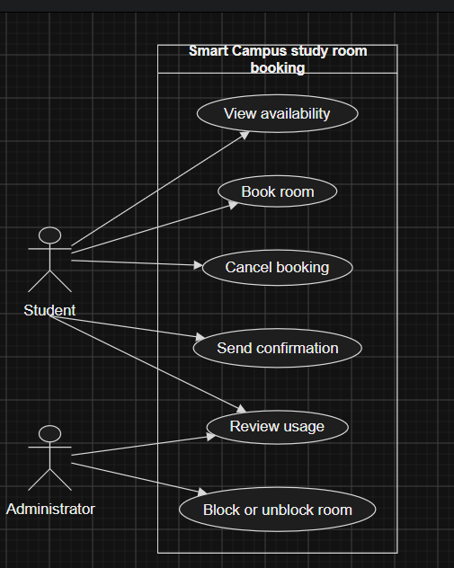

# Lab report — Practice #03, Requirements Engineering with AI

Fill in every section. **Do not delete or renumber the headings** — the README points at them and a
missing heading reads as a missing section.

Name: Kirillov Grigoriy
Student ID: 24B031850
GitHub username: gkirillovKBTU

---

## 1. Setup

| | |
| --- | --- |
| AI assistant (tool) | Codex |
| Exact model name and version | gpt-5.6-terra |
| Date of the session | 27.09.2026 |
| Diagram renderer used | draw.io |

One tool and one model for all three prompts. If you switched, say why here — it changes what your
findings mean.

---

## 2. Original AI output — user stories (Part 1)

```
1. As a Student, I want to see which study rooms are available, so that I can select a room for studying. Priority: High. Assumption: availability is current.
2. As a Student, I want to reserve a study room, so that I have a space for individual or group study. Priority: High. Assumption: the chosen room is free.
3. As a Student, I want to cancel my reservation, so that another student can use the room. Priority: Medium. Assumption: students can cancel their own reservations.
4. As an Administrator, I want to block or unblock rooms, so that unavailable rooms are not reserved. Priority: High. Assumption: an administrator can change a room status.
5. As an Administrator, I want to review room usage, so that I understand demand for study rooms. Priority: Medium. Assumption: usage can be viewed for a period.
6. As a System, I want to send booking and cancellation confirmations, so that users know about changes. Priority: Medium. Assumption: confirmations are sent after changes.
7. As a Student, I want to view my booking confirmation, so that I know my booking was successful. Priority: Low. Assumption: the confirmation is available after booking.
```

---

## 3. Story review (Part 2)

One row per change you made. "Kept unchanged" is a valid row and needs a reason too.

| Story (as generated) | What I did | Why | Final ID |
| --- | --- | --- | --- |
| 1. As a Student, I want to see which study rooms are available, so that I can select a room for studying. Priority: High. Assumption: availability is current.  | Rewrote and kept | Added a specific time slot and observable unavailable status. | US-01 |
| 2. As a Student, I want to reserve a study room, so that I have a space for individual or group study. Priority: High. Assumption: the chosen room is free.| Rewrote | Added future start, duration, overlap, and blocked-room constraints as the booking outcome. | US-02 |
| 3. As a Student, I want to cancel my reservation, so that another student can use the room. Priority: Medium. Assumption: students can cancel their own reservations.| Rewrote and kept | Made the released reservation the valuable outcome. | US-03 |
| 4. As an Administrator, I want to block or unblock rooms, so that unavailable rooms are not reserved. Priority: High. Assumption: an administrator can change a room status.| Rewrote and kept | Clarified that blocking and unblocking is one room-status goal. | US-04 |
| 5. As an Administrator, I want to review room usage, so that I understand demand for study rooms. Priority: Medium. Assumption: usage can be viewed for a period. | Rewrote and kept | Specified that usage is reviewed over a period. | US-05 |
| 6. As a System, I want to send booking and cancellation confirmations, so that users know about changes. Priority: Medium. Assumption: confirmations are sent after changes.| Rewrote | System is not an allowed stakeholder; changed it to the Student outcome. | US-06 |
| 7. As a Student, I want to view my booking confirmation, so that I know my booking was successful. Priority: Low. Assumption: the confirmation is available after booking.| Deleted | It duplicated the confirmation goal after US-06 was revised. | — |
| New administrator confirmation story | Added | A status-change confirmation gives UC-06 support for room blocking. | US-07 |

**Did the assistant invent anything outside the scenario?** No. I checked every generated goal against the out-of-scope list: no payments, attendance, maintenance, notifications beyond confirmation, account features, queues, or technical/interface details appeared.

**How many stories did you end with, and why that number?** Seven. This covers the six fixed functions while retaining a separate administrator confirmation outcome without duplicating the student confirmation story.

---

## 4. Original AI output — acceptance criteria (Part 3)

```
Assumptions:
- A booking ending when another begins is allowed because the bookings do not overlap.
- Exactly two hours is allowed because otherwise cosntantly changing rooms might lead to confusion/inconvenience

US-01 View availability
AC-01 Given rooms have bookings When a Student views availability Then free rooms are shown.
AC-02 Given a room is blocked When a Student views availability Then it is unavailable.
AC-03 Given one booking ends at 14:00 When another slot starts at 14:00 Then the room is available.

US-02 Book room
AC-04 Given a free room and a future two-hour slot When a Student books it Then the booking is created and confirmation is sent.
AC-05 Given a room When a Student requests a past slot Then the booking is rejected.
AC-06 Given a room When a Student requests more than two hours Then the booking is rejected.
AC-07 Given an existing booking When a Student requests an overlapping slot Then the booking is rejected.

US-04 Block or unblock room
AC-08 Given an unblocked room When an Administrator blocks it Then it cannot be booked.
AC-09 Given a blocked room When an Administrator unblocks it Then it can be booked.
AC-10 Given a blocked room When an Administrator blocks it again Then it stays blocked.
```

---

## 5. Criteria review (Part 3)

| Criterion (as generated) | Problem | What I changed it to | Final ID |
| --- | --- | --- | --- |
| AC-01 | Did not state the selected slot or unavailable result. | Added a selected future time slot and free/unavailable room results. | AC-01 |
| AC-02 | Kept | Stated that a blocked room is unavailable for the selected slot. | AC-03 |
| AC-03 | Kept | Stated the 14:00 touching boundary clearly. | AC-02 |
| AC-04 | Kept | Added free, unblocked, exactly-two-hour conditions. | AC-04 |
| AC-05 to AC-07 | Kept and clarified observable rejection. | Added specific conditions for past, too-long, and overlap requests. | AC-05 to AC-07 |
| AC-08 | The generated booking set omitted R4. | Added rejected booking for a blocked room. | AC-08 |
| AC-09 to AC-10 | Kept and clarified conditions. | Renumbered after the new booking criterion and added observable status results. | AC-09 to AC-11 |

**The two open questions.** Write your decision and the reason. Either answer is accepted.

| Question | My decision | Why |
| --- | --- | --- |
| A booking ending exactly when another begins — overlap under R3? | allowed | the time intervals share no time. |
| Is exactly two hours allowed under R2? | allowed | cosntantly changing rooms might lead to confusion/inconvenience |

**Which invalid or boundary case did the assistant leave out?** The original criteria omitted the R4 case where a Student attempts to book a blocked room.

---

## 6. Original AI output — use-case diagram (Part 4)

```
@startuml
left to right direction
actor Student
actor Administrator
rectangle "Smart Campus study room booking" {
  usecase "View availability" as UC01
  usecase "Book room" as UC02
  usecase "Cancel booking" as UC03
  usecase "Block or unblock room" as UC04
  usecase "Review usage" as UC05
  usecase "Send confirmation" as UC06
}
Student --> UC01
Student --> UC02
Student --> UC03
Student --> UC05
Administrator --> UC04
Administrator --> UC05
Student --> UC06
@enduml
```

Rendered diagram (image, or a link): 

---

## 7. Diagram review (Part 4)

| Element | Problem | What I changed |
| --- | --- | --- |
| Student → Review usage | Usage review is administrator's responsibility. | Removed the association. |
| Student → Send confirmation | No person triggers confirmation; it follows booking or cancellation. | Removed the association |

**Associations.** Which actor–use-case links did the assistant draw that a person does not actually trigger? Student → Send confirmation was not person-triggered. Student → Review usage was also an incorrect responsibility association.

**Did any screen, database or internal component appear as a use case or an actor?** No.

---

## 8. Traceability (Part 5)

Summarise what the table in `requirements/traceability.md` shows:

- Use cases with **no story** behind them: none
- Stories with **no use case** they belong to: none
- Criteria that test **no rule** from section 1: AC-01, AC-03, AC-09, AC-10, and AC-11 test functional outcomes rather than R1–R4.

**What does the largest gap tell you about the generated requirements?** UC-03 and UC-05 have stories but no selected acceptance-criteria sets. UC-06 also has only partial evidence because AC-04 checks booking confirmation but not cancellation confirmation. The generation covered the main booking constraints better than cancellation and usage-review testability.

---

## 9. Checker runs

Paste the **real terminal output** of both runs. A table with nothing behind it does not count.

```
PASS   US-1  user-stories.md         no placeholders left
PASS   US-2  user-stories.md         7 stories, IDs US-01…US-07
PASS   US-3  user-stories.md         every story has the required sentence shape
PASS   US-4  user-stories.md         every story has a priority
PASS   US-5  user-stories.md         every story declares an assumption
PASS   US-6  user-stories.md         only Student and Administrator appear as roles
PASS   US-7  user-stories.md         nothing from the out-of-scope list appears
PASS   AC-1  acceptance-criteria.md  no placeholders left
PASS   AC-2  acceptance-criteria.md  three sections, all naming real stories: US-01, US-02, US-04
PASS   AC-3  acceptance-criteria.md  every section has 3 to 5 uniquely numbered criteria
PASS   AC-4  acceptance-criteria.md  all 11 criteria are complete Given/When/Then
PASS   AC-5  acceptance-criteria.md  every section covers an invalid or boundary case
PASS   AC-6  acceptance-criteria.md  3 assumptions listed before the criteria
PASS   AC-7  acceptance-criteria.md  both open questions are settled in the assumptions
PASS   PU-1  use-cases.puml          valid PlantUML block, no placeholders
PASS   PU-2  use-cases.puml          exactly two actors: Student, Administrator
PASS   PU-3  use-cases.puml          all six use cases present
PASS   PU-4  use-cases.puml          system boundary present
PASS   PU-5  use-cases.puml          no screens, databases or internal components
PASS   PU-6  use-cases.puml          no unjustified actor associations found
PASS   TR-1  traceability.md         all six use cases have a row
PASS   TR-2  traceability.md         every ID in the table resolves
PASS   TR-3  traceability.md         every story appears in the table
------------------------------------------------------------------------
23 PASS · 0 FAIL · 0 ERROR   (23 checks)
Shape is clean. This says nothing about whether the requirements are good.
```

```
PASS   schema                                    1
PASS   week                                      03
PASS   student.name                              Kirillov Grigoriy
PASS   student.student_id                        24B031850
PASS   student.github                            gkirillovKBTU
PASS   assistant.tool                            Codex
PASS   assistant.model                           gpt-5.6-terra
PASS   counts.user_stories                       7
PASS   counts.acceptance_criteria_sets           3
PASS   checker                                   23 PASS · 0 FAIL · 0 ERROR
NOTE   checker                                   you are claiming a clean run — it will be re-run at your commit, so make sure it is true
PASS   checker.commit                            a0285f43e01aef167edb45ccde27b3978a29b530
PASS   assumptions.overlap_touching_bookings     allowed
PASS   assumptions.exactly_two_hours             allowed
PASS   traceability.use_cases_not_covered        UC-03, UC-05, UC-06
PASS   traceability.stories_not_traced           US-07
PASS   review_findings                           3 findings
PASS   review_findings[1]                        US-02 was revised to state future start, maximum duration, o…
PASS   review_findings[2]                        AC-04 through AC-08 test all booking rules, including the ex…
PASS   review_findings[3]                        UC-06 is system-triggered after booking or cancellation
PASS   honesty.can_explain_everything_submitted  yes
PASS   honesty.ai_usage_disclosed                yes
------------------------------------------------------------------------
21 PASS · 0 FAIL · 0 ERROR · 1 note
Shape is fine. This says nothing about whether the work is good.
```

| | PASS | FAIL | ERROR |
| --- | --- | --- | --- |
| `check_requirements.py` | 23| 0 | 0 |

Commit these numbers were produced at (`git rev-parse --short HEAD`): Not available; Git commands are unavailable in this workspace.

**Every FAIL, one line each: what it is and what you decided to do about it.**

**Did you run the checks by hand instead of with Python?** Python was used

---

## 10. Conclusion (150–200 words)

The most wrong part of the generated requirements was the treatment of responsibility boundaries. The generated US-06 used “System” as a stakeholder, even though the scenario permits only Student and Administrator. The diagram also connected Student to UC-05 Review usage and UC-06 Send confirmation. I could catch these without a checker by listing the two allowed actors first, then asking whether each association represents an action a person initiates. Send confirmation happens as a consequence of booking or cancellation, rather than from a separate human request.

The assistant did give a useful starting structure quickly: it covered all main room actions, included priorities and assumptions, and identified the future-start, duration, and overlap constraints for booking.

I would rewrite US-06 first before implementation. It says a Student receives confirmation, but it needs an agreed observable form and needs to cover both successful booking and successful cancellation.
